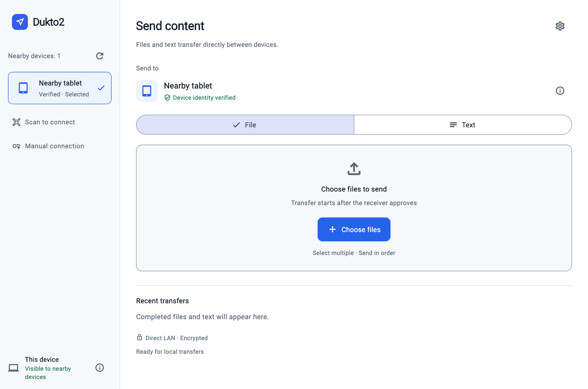

# Dukto2

English | [Simplified Chinese](README.zh-CN.md)

Dukto2 shares files and text directly between computers, phones and tablets on the same local network. No account or cloud upload is required: connect to a device, choose what to send, and transfer after the receiver approves.

## Features

- **Cross-platform sharing**: macOS, Windows, Linux, Android and iPhone / iPad, with layouts for desktops, phones and tablets. Tested coverage is listed below.
- **Direct LAN transfers**: content travels between devices without an internet relay, over wireless or wired networks.
- **Flexible connections**: discover nearby devices automatically, scan a connection QR code, or connect manually. Devices on different subnets can connect when direct communication is allowed.
- **Files and text**: send a single file, a batch of files, text messages or UTF-8 text files. The receiver explicitly approves before transfer begins.
- **Streaming large files**: bounded reads and writes avoid loading entire files into memory. Track progress and speed, cancel a transfer, and verify size and SHA-256 before completion.
- **Encryption and identity checks**: HTTPS / TLS protects transfers. QR connections match the full certificate fingerprint; manual connections use a verification code. Sending pins the verified destination certificate.
- **Receiving folders and history**: choose a destination, browse recent transfers, filter by device, open a file's folder or view received text.
- **Languages and appearance**: choose from 10 languages, remember your preference, and follow the system theme or select light / dark mode.

## Version and platform coverage

The source is a **0.1.6-rc.10 development preview**, hosted at [lvjing2/dukto2](https://github.com/lvjing2/dukto2). Preview downloads are available from [GitHub Releases](https://github.com/lvjing2/dukto2/releases); Android APKs use the project application-signing key, while desktop signing and installation limits are listed in the [direct-download guide](docs/en/direct-downloads.md). Store distribution is pending. Legacy Dukto compatibility, resumable transfers and folder transfers are not implemented. Repository documentation is available in English and Simplified Chinese; the app supports 10 languages, follows the system by default, and remembers a language selected in Settings.

| Platform | Verified | Not yet covered |
| --- | --- | --- |
| macOS | Apple Silicon hardware; files, text, receiving folders and batches | Intel and all minimum OS versions |
| Android | Android 16 hardware; files, text and selected large-file, screen-off, background and interruption scenarios | Other vendors and older devices; indefinite background execution |
| iPhone / iPad | File and text exchange in simulators; physical iPad ↔ Mac | Physical iPhone, older OS versions and background scenarios |
| Windows | Windows 11 x64 builds, desktop launch and bidirectional files / text with Mac | Windows 10, ARM64 hardware, large files and full revalidation of current shared code |
| Linux | Ubuntu 24.04.3 x64 builds and bidirectional files with Mac; 0.1.6 receiving folders, opening folders, notifications and sleep inhibition | Text, full revalidation of current GUI sending, other distributions and ARM64 hardware |

These are tested environments, not a guarantee for every device. See [validation coverage](docs/en/validation.md).

## Screenshots



Rendered from the current English Flutter interface with a sample device and no transfer history. See [English interface previews](docs/screenshots/README.en.md) for phone and tablet layouts; these previews do not represent device-transfer tests.

## Requirements

- Flutter **3.47.7 stable** / Dart **3.13.5**; exact dependencies are locked in both `pubspec.lock` files.
- macOS: minimum macOS 12, full Xcode and its initial setup. Apple Silicon is tested; Intel is not. Follow `flutter doctor` and build output for plugin toolchain requirements.
- Android: Java 17+, Android SDK 36 / Build Tools 36 and adb; minimum Android 7 (API 24). Flutter / Gradle downloads the required NDK as needed.
- iPhone / iPad: minimum iOS / iPadOS 15 and full Xcode. Physical devices require your own signing setup; see [iOS](docs/en/ios.md).
- Windows: Windows with the Visual Studio C++ desktop toolchain and Windows SDK; see [Windows](docs/en/windows.md).
- Linux: Linux, Clang, CMake, Ninja and GTK3 development libraries; see [Linux](docs/en/linux.md).
- Devices on the same LAN, with communication between devices allowed by the router.

Use Flutter on PATH or set `FLUTTER_BIN`. SDKs and personal signing material are not part of the repository.

## Run

```sh
./tool/flutterw pub get
./tool/flutterw doctor -v
./tool/flutterw run -d macos
# Find an Android device ID, then run:
./tool/flutterw devices
./tool/flutterw run -d <android-device-id>
```

Build an Android development package:

```sh
./tool/flutterw build apk --debug
adb install -r build/app/outputs/flutter-apk/app-debug.apk
```

Debug packages use development signing. Android release signing uses separate application and upload keys; see [channel signing](docs/en/android-signing.md). Initial Play enrollment and real cross-channel upgrades remain outstanding. Production Apple signing and automatic updates are not configured.

## Use

1. Open the app on both devices and select / approve transfers in the foreground. Allow the required local-network access. Android provides a foreground transfer service; see its [tested limits](docs/en/validation.md).
2. Select a nearby device, or enter the IPv4 address and port shown in the other device's local information.
3. **Read the verification code on the receiving device itself** and compare the 16 hexadecimal characters with the connection dialog. Names and discovery messages do not prove identity.
4. Select files, review names and sizes, and explicitly send. The receiver approves; completion requires matching SHA-256 and a successful save acknowledgement.
5. Change the destination in Settings. macOS, Windows, Linux and Android 10+ default to Downloads / Dukto2. Android 7–9 can use an authorized SAF folder; otherwise files remain in app storage for export. iPhone / iPad default to Files → Dukto2 → the default receiving folder shown in Settings. Directory access is remembered. Changing folders does not move or delete existing files.

App-storage and SAF transfers use separate subdirectories; MediaStore creates new download entries. Existing files are not overwritten. Incomplete files are not reported as successful and app-owned temporary data is cleaned up after restart. The last 100 completed history entries are stored locally.

## Settings and history

The gear opens receiving location, read-only system device name, completion notifications, appearance and About. Folder controls live in Settings. Notification display also depends on system permission; Android's ongoing service notification is separate. Appearance can follow the system or use light / dark mode.

Recent transfers can be filtered by historical device name, including offline devices, and show up to 20 matching entries. Names, direction and device are grouped separately from completion time and duration. Each row has one action: view text or open the file's folder. Copying happens in text details. Duration starts with payload transfer and excludes approval waiting; missing durations in old history are not invented. See [settings](docs/en/settings.md) and [batch transfers and history](docs/en/batch-and-history.md).

## Batch files

The system picker supports multiple files. Review the list and send; the receiver approves the exact manifest once. Files are streamed, verified and committed sequentially. Cancellation or failure stops remaining items; completed files stay saved. Continue sends only unfinished items and requests fresh consent. Both peers need batch support (0.1.4 or later). Selecting another device resets the sending state. Queues are not persisted across restarts.

## Text

Select and verify a device, choose text, type or explicitly paste, then send. The receiver approves before the UTF-8 payload is transferred and checked. Received text can be viewed and copied; there is no automatic clipboard access or synchronization.

The limit is **16 MiB (16,777,216 UTF-8 bytes)**. The editor accepts up to 1 MiB; larger text can be loaded from a file and streamed. Received text above 1 MiB is saved to the destination with a bounded history preview and actions to copy the preview or open the full text. Clipboard capacity is controlled by the OS. Text and previews are stored in private app history; large bodies are stored in the chosen folder.

On mobile, focusing the editor switches to a compact keyboard layout; closing the keyboard preserves the draft and scroll position. Peers without text capability are asked to update. See [receiving folders and text](docs/en/receive-and-text.md).

## Transfer behavior and limits

- HTTPS confirms UDP / Bonjour candidates; peers are deduplicated by certificate and removed when stale. Interface changes refresh discovery. Bounded private IPv4 /24 probing and manual IPv4 remain available when multicast fails.
- For reachable routed subnets, manually connect and compare codes once. Up to 32 confirmed endpoints are cached locally and retried after restart against their original identities. Unicast announcements allow reciprocal discovery where UDP and reverse HTTPS are permitted. Changed addresses or network isolation may still require manual connection. First-time discovery across subnets requires network discovery forwarding or an additional discovery service; the app does not scan entire private address ranges.
- To connect without typing an IP, show the QR code in the other device's information panel and choose Scan to connect. Android, Mac, Windows and iPhone / iPad provide the scanner. Windows also reads QR codes from PNG, JPEG and BMP images; see the [Windows guide](docs/en/windows.md). It tries the private IPv4 endpoints and matches the full QR certificate fingerprint before connecting directly, without a second code comparison. File reception still requires consent. Different subnets on the same network work when direct communication is allowed. QR display stays in device information; the home screen has compact Scan to connect and Manual connection actions. Android bundles the scanner model for offline use. Camera access is used only on the scan page. See [validation coverage](docs/en/validation.md) for physical-device coverage.
- Each installation has its own TLS identity. After code comparison, the sender pins the full certificate fingerprint.
- Single-file, batch and text transfers use bounded streams, progress, cancellation, explicit approval, size checks, SHA-256 and temporary targets committed only after validation.
- The UI adapts between desktop columns and mobile layouts, supports light / dark themes and requires foreground approval. Back / Escape declines the current request.
- Android provides a dataSync foreground service, progress / cancellation notification, MediaStore / SAF storage and legacy-file export. Apple discovery includes Bonjour; see [iOS](docs/en/ios.md).

Not implemented: folders, automatic clipboard sync, resumable transfers, IPv6, concurrent task queues or legacy Dukto compatibility. Network loss or process termination requires restarting the transfer. Background execution is limited by OS and vendor policies; it does not imply indefinite listening or automatic acceptance. Cancellation cannot retract already committed files.

## Tests and CLI

```sh
./tool/check.sh
```

Checks include real TLS / UDP core tests and mobile / desktop widget tests. Device validation separately checks both directions and independently hashes saved files.

For controlled development use, the same core provides a CLI:

```sh
cd packages/dukto2_core
dart pub get
dart run bin/dukto2.dart receive --dir ./received --name Mac
# Probe only reads identity; compare the code on the receiver before sending:
dart run bin/dukto2.dart probe --host 192.168.1.20 --port 54321
dart run bin/dukto2.dart send --host 192.168.1.20 --port 54321 \
  --code 'AAAA BBBB CCCC DDDD' --file ./example.bin
```

`receive --auto-accept` is for controlled local tests only. The GUI always requires receiving consent.

## Repository layout

- `lib/`: Flutter UI, application state and platform integration.
- `packages/dukto2_core/`: Flutter-independent discovery, identity, transfers and CLI.
- `android/`, `macos/`, `ios/`, `windows/`, `linux/`: platform projects and native adapters.
- `apple/`: shared Apple Bonjour integration.
- [Protocol](docs/en/protocol-v1.md), [reliability](docs/en/reliability.md), [validation](docs/en/validation.md) and [documentation index](docs/en/README.md).

Android settings explicitly read SDK paths as UTF-8. Checks use `dart analyze` to avoid the current Flutter LSP's Unicode-path initialization issue.

## Contributing

Read [CONTRIBUTING.md](CONTRIBUTING.md), [SECURITY.md](SECURITY.md), [CHANGELOG.md](CHANGELOG.md) and [Release CI](docs/en/release-ci.md). Issues and pull requests are welcome in English or Simplified Chinese.

GitHub Actions provides analysis, tests and native builds for five platforms; version tags can create draft releases. Successful builds do not replace device validation. Android APK / AAB signing is configured; initial Play enrollment, store delivery, production Apple signing and automatic updates remain outstanding.

## A tribute to Dukto

Thank you to **Emanuele Colombo**, creator of [Dukto](https://www.msec.it/blog/dukto/), and to [xuzhen/dukto](https://github.com/xuzhen/dukto) and the community for maintaining and porting the project.

The original author has agreed to the Dukto2 name, provided the source remains open. Dukto2 uses [Apache-2.0](LICENSE), is independently maintained by lvjing2, and handles support through [Issues](https://github.com/lvjing2/dukto2/issues).

The project aims to be an independent Flutter / Dart rewrite with its own transfer core and protocol. Legacy Dukto protocol compatibility is planned for future work. See [acknowledgements](ACKNOWLEDGEMENTS.md).

## Created with AI assistance

This project is primarily created by **OpenAI Codex under human direction**, including code, UI proposals, tests and documentation. The human initiator sets goals, chooses approaches and reviews results. Development used GPT-6.1 Sol and design guidance including UI UX Pro Max. We disclose that process rather than presenting AI-generated work as wholly handwritten.

Executed checks and device tests, including their limits, are listed in [validation coverage](docs/en/validation.md).

Dukto2's own code is licensed under [Apache License 2.0](LICENSE) (`Apache-2.0`). Third-party code, templates and dependencies retain their licenses; see [third-party notices](THIRD_PARTY_NOTICES.md).
