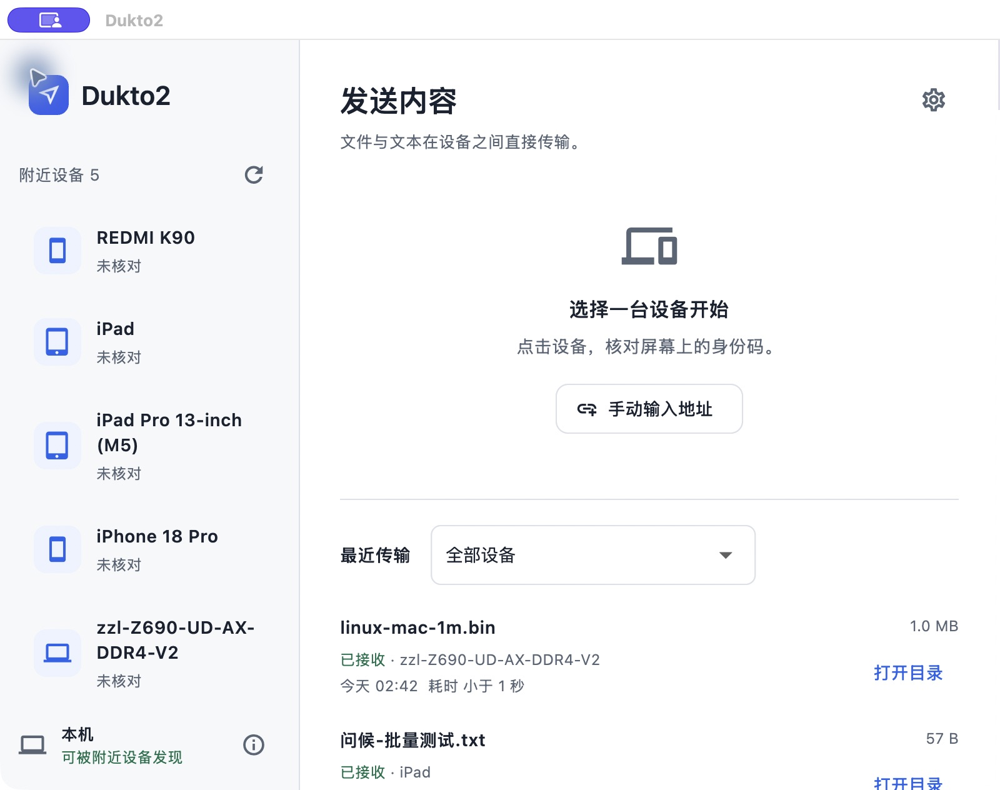

# Dukto2

[English](README.md) | 简体中文

Dukto2 是一款跨平台局域网文件与文本传输工具，让电脑、手机和平板在同一网络中直接交换内容。无需注册账户或上传云端，连接设备、选择内容，经对方确认后即可传输。

## 功能与特色

- **跨平台互传**：覆盖 macOS、Windows、Linux、Android 和 iPhone / iPad，界面适配桌面、手机与平板；各平台实测范围见下表。
- **局域网直连**：设备之间直接传输，不经过互联网中继，适用于无线或有线网络。
- **多种连接方式**：自动发现附近设备，也可扫码连接或手动连接；不同子网的设备，只要能够直接通信，也可以连接。
- **文件与文本**：支持单文件、多文件批量发送，以及文本消息和 UTF-8 文本文件，接收方明确确认后开始传输。
- **大文件流式传输**：分段读写，避免把整个文件载入内存；提供进度、速度显示与取消操作，完成前校验文件大小和 SHA-256。
- **加密与身份校验**：使用 HTTPS / TLS，扫码校验完整证书指纹，手动连接核对设备码；发送时固定已验证的目标证书。
- **接收目录与历史**：可选择接收位置，查看最近传输、按设备筛选记录，并打开文件所在目录或查看收到的文本。
- **多语言与外观**：支持 10 种语言，记住语言选择，支持跟随系统、浅色与深色主题。

## 版本与平台验证

当前源码为 **0.1.6-rc.10 开发预览**，仓库为 [lvjing2/dukto2](https://github.com/lvjing2/dukto2)，[GitHub Releases](https://github.com/lvjing2/dukto2/releases) 已提供预览下载；Android APK 使用项目应用签名密钥，桌面签名与安装限制见 [直接下载发行方案](docs/direct-downloads.md)，应用商店分发尚待接入。未实现旧 Dukto 协议兼容、断点续传或文件夹传输。

| 平台 | 已完成验证 | 尚未覆盖或完成 |
| --- | --- | --- |
| macOS | Apple Silicon 真机，文件与文本、接收目录、批量传输 | Intel、所有最低系统版本 |
| Android | Android 16 真机，文件与文本；部分大文件、锁屏、后台和中断场景 | 跨厂商与老系统；后台不保证永久运行 |
| iPhone / iPad | iPhone 与 iPad 模拟器文件、文本互传；iPad 真机与 Mac 互传 | iPhone 真机、所有旧系统和后台场景 |
| Windows | Windows 11 x64 构建、启动，与 Mac 双向文件和文本 | Windows 10、ARM64、大文件及新版共享代码完整复验 |
| Linux | Ubuntu 24.04.3 x64 构建、启动，与 Mac 双向文件；0.1.6 接收目录、打开目录、通知与防休眠 | 文本互传、新版 GUI 发送方向完整复验、其他发行版和 ARM64 |

这张表区分实际验证与目标兼容范围，不表示覆盖所有设备。详见 [验证记录](docs/validation.md)。

仓库文档提供中英文两版；App 支持 10 种语言，默认跟随系统，可在设置中切换并记住选择。

## 界面



更多实际设备及模拟器图片见 [截图说明](docs/screenshots/README.md)，其中 Windows、Linux 图片保留了测试时的原始桌面环境。

## 环境

- Flutter **3.47.7 stable** / Dart **3.13.5**，具体依赖版本见两个 `pubspec.lock`。
- macOS：最低 macOS 12；当前已验证 Apple Silicon，Intel 尚未实测。需要完整 Xcode，按 Flutter doctor 提示完成首次初始化；插件需要的 CocoaPods / Swift 工具链以 doctor 和实际构建结果为准。
- Android：Java 17+，Android SDK 36 / Build Tools 36，adb；最低 Android 7（API 24）。NDK 由 Flutter/Gradle 按需安装。
- iPhone / iPad：最低 iOS / iPadOS 15，需要完整 Xcode。模拟器可直接编译，真机需自行配置 Apple 签名；接入与验证范围见 [iOS 说明](docs/ios.md)。
- Windows：已验证 Windows 11 x64，Windows 10 尚未实测。编译需要 Windows、Visual Studio C++ 桌面工具链与 Windows SDK；见 [Windows 说明](docs/windows.md)。
- Linux：已验证 Ubuntu 24.04.3 x64，编译需要 Linux、Clang、CMake、Ninja、GTK3 开发库；见 [Linux 说明](docs/linux.md)。
- 手机与电脑连接同一局域网，路由器允许设备间通信。

使用 PATH 中的 Flutter，或通过 `FLUTTER_BIN` 指定 SDK 路径；工具链和个人签名不属于源码仓库。

## 启动

```sh
./tool/flutterw pub get
./tool/flutterw doctor -v
./tool/flutterw run -d macos
# 查看 Android 真机 ID 后运行：
./tool/flutterw devices
./tool/flutterw run -d <android-device-id>
```

生成 Android 测试安装包：

```sh
./tool/flutterw build apk --debug
adb install -r build/app/outputs/flutter-apk/app-debug.apk
```

调试包使用开发签名，不代表正式商店发行版本。Android 发布签名采用独立应用密钥与上传密钥，见 [双渠道签名](docs/android-signing.md)；首次 Play 配置与实际跨渠道升级尚待完成。Apple 正式签名和自动更新尚未配置。

## 使用

1. 两台设备打开应用，在前台选择设备与确认收发。允许 macOS 的本地网络访问/防火墙接入。Android 已接入传输前台服务，后台范围见 [验证说明](docs/validation.md)。
2. 在「附近设备」选择目标。如果未发现，可输入对方「本机信息」中显示的 IPv4 地址与端口。
3. **实际查看接收设备上的本机核对码**，与连接对话框中的 16 位十六进制码核对一致后确认。名称和自动发现信息不是可信身份凭据。
4. 点击「选择文件」，核对文件名与大小后点击「发送文件」。接收方确认后传输，双方 SHA-256 一致且接收方确认落盘后显示完成。
5. Android 10+ 默认直接保存到「下载 / Dukto2」，可通过「设置 → 接收位置」改用系统授权文件夹。Android 7–9 授权文件夹后可直接接收；未授权时保留应用内接收与「保存到…」。macOS、Windows 和 Linux 默认保存到「下载 / Dukto2」，可更改并记住目录，也可恢复默认。iPhone / iPad 默认保存至「文件 → Dukto2 → 接收文件」，可更改目录并记住授权。更改接收位置不会移动或删除已有文件。

应用内及 SAF 文件夹接收使用独立子目录；Android 系统下载目录由 MediaStore 创建新条目处理重名，不覆盖旧文件。未完成的文件不显示为成功，重启时会清理上次遗留的临时文件。接收记录保存于本机，保留最近 100 条。

## 设置

主界面点击齿轮进入设置，统一管理接收位置、设备名称、通知和外观。主界面不再展示接收位置或提供更改入口。「关于 Dukto2」位于设置页底部，主界面右上角只保留设置等常用入口。

- **接收位置**：更改授权文件夹或恢复默认，保留原有目录记忆。
- **设备名称**：只读展示系统名称，系统名称变化后更新附近设备中的名称；不提供应用内改名。
- **通知**：开关传输完成提醒，并查看或请求系统通知权限。系统未授权时不会弹出完成通知；Android 传输过程中的状态通知由系统管理。
- **外观**：跟随系统、浅色、深色，重启后恢复所选模式。

最近传输支持按历史设备名称筛选，包括离线设备；筛选后展示最近 20 条记录。左侧显示收发状态、完成时间及已记录的耗时，右侧仅保留一个操作：文本「查看文本」，文件「打开目录」。耗时从上传开始计至校验完成，不包含等待接收确认；旧记录没有耗时时不补造数值。复制文本或预览在查看窗口中完成。没有可用本机位置的文件记录会禁用目录按钮。详细说明和验证范围见 [设置与通知](docs/settings.md)。

## 批量文件

「选择文件」支持系统选择器一次多选，确认清单后点击发送。接收方查看文件清单与总大小后点击一次「接收全部」，本批文件按顺序传输并逐项校验，不会整批读入内存。授权仅限本批清单，取消或失败停止余下队列；「继续发送」只发送未完成项，并重新请求确认剩余清单。两端需更新至 0.1.4 或支持 `batch` 能力的版本。切换接收设备后整份清单重新准备发送。队列仅在当前应用会话保留，未实现跨重启队列或断点续传。

## 文本发送

选择并核对设备后，切换到「文本」，输入内容或点击粘贴图标，再点击「发送」。接收方确认后，经 UTF-8、长度及 SHA-256 校验完成，文本进入最近传输，可查看与复制。不会自动读取或覆盖剪贴板。手机端点击输入框后进入紧凑编辑态，发送工具栏位于键盘上方；收起键盘返回主界面并保留草稿及页面位置。

文本上限 **16 MiB（16,777,216 个 UTF-8 字节）**。编辑区适合 1 MiB 以内的文本；更长的日志、代码等使用「更多文本操作 → 载入文本文件」，以流式方式发送。超过 1 MiB 的接收文本直接保存到接收位置，历史只保留有界预览，提供「复制预览」和「打开完整文本」。系统剪贴板容量仍由操作系统决定。文本与文本预览保存在本机应用私有历史中；大文本正文位于所选接收文件夹。

旧版未声明文本能力时，发送入口会提示更新对方应用。文件传输保持兼容。

## 当前范围

- Apple 端增加 Bonjour 候选发现，iOS 使用系统 Bonjour 与 UDP 单播，避免依赖受限自定义组播权限。候选仍由 HTTPS 确认；详见 [iOS 说明](docs/ios.md)。
- UDP 候选经 HTTPS 确认后展示；按接口公告、启动重发、切网重新订阅、证书去重和过期移除。组播不可用时限流探测直接连接的私有 IPv4 /24 网段，保留手动 IPv4 连接。
- 跨子网但可直连时，首次可手动输入对方地址并核对设备码；本机最多保存 32 个已核对设备的地址，重启后自动探测并核对原身份。向已发现设备发送单播通告，网络允许 UDP 与反向 HTTPS 时，对方也能发现本机。地址改变或网络隔离时仍可能需要手动连接。首次发现未知的跨子网设备需要网络转发发现流量或额外的发现服务，本项目不扫描整个私有大网段。
- 首次连接也可免输 IP：在对方的「本机信息」中显示二维码，本机点击「扫码连接」，按提示允许相机并扫描。Android、Mac、Windows 和 iPhone / iPad 提供扫码入口；Windows 还支持从 PNG、JPEG、BMP 图片识别二维码，自动尝试二维码中的私有 IPv4 地址，校验完整证书指纹后直接连接，无需再次核对设备码；文件接收仍需确认。同一网络下不同子网也可使用，前提是设备能够直接通信。二维码只在「本机信息」中显示；主页保留轻量的「扫码连接」与「手动连接」入口。Android 扫码模型随应用提供，无需首次联网下载；仅进入扫码页面时使用相机。Windows 扫码说明见 [Windows 文档](docs/windows.md)；真机扫码的验证范围见 [验证记录](docs/validation.md)。
- 每个安装生成独立 TLS 身份；核对码确认后固定目标证书指纹。
- 每次单文件流式上传，独立选择与发送步骤；另支持 UTF-8 文本与大文本文件载入，双向收发、进度和取消。
- 蓝色极简界面、宽窗口双栏 / 手机单列，跟随系统深浅色并支持手动切换。
- 接收请求前台弹层，返回键 / Esc 拒收，请求过期只关闭对应弹层。
- 接收确认、大小验证、SHA-256、临时文件提交、跨目录/非法文件名防护。
- macOS 沙箱网络权限与文件选择权限；Android 多播锁、dataSync 前台服务、进度 / 取消通知、直接接收至系统下载目录或已授权文件夹，保留历史文件导出。

各平台已执行的互传、批量、大文件及后台检查统一列于 [验证范围](docs/validation.md)，不以旧安装包结果代替当前源码的完整复验。

尚未实现：文件夹传输、自动剪贴板同步、断点续传、IPv6、多任务队列、旧 Dukto 兼容。后台继续传输与进程死亡后继续传输不同：强行停止应用或网络中断后仍需从头重试。Android 后台服务受系统时间及厂商省电限制，未承诺永久驻留或后台自动接受新请求。取消不是撤回：已完成并提交的文件会保留。

## 测试

```sh
./tool/check.sh
```

包含核心的真实 TLS/UDP 测试及手机/桌面布局测试。实际跨系统验收应包含 Mac → Android 和 Android → Mac，检查接收端落盘文件的大小与 SHA-256。

也可使用同一核心的 CLI 进行开发调试与受控互传：

```sh
cd packages/dukto2_core
# dart 可以使用 Flutter SDK bin/cache/dart-sdk/bin/dart。
dart pub get
dart run bin/dukto2.dart receive --dir ./received --name Mac
# probe 只读取身份，发送前仍必须核对接收设备上的码：
dart run bin/dukto2.dart probe --host 192.168.1.20 --port 54321
dart run bin/dukto2.dart send --host 192.168.1.20 --port 54321 \
  --code 'AAAA BBBB CCCC DDDD' --file ./example.bin
```

`receive --auto-accept` 仅供受控本地测试，图形应用始终要求接收确认。

## 目录

- `lib/`：Flutter 界面、状态和平台集成。
- `packages/dukto2_core/`：不依赖 Flutter 的发现、身份、收发与 CLI。
- `android/`、`macos/`、`ios/`、`windows/`、`linux/`：Flutter 平台工程及原生适配。
- `apple/`：Apple 平台共用的 Bonjour 发现适配。
- `docs/protocol-v1.md`：协议和信任边界。
- `docs/validation.md`：自动化、模拟器和真实设备的验证范围。
- `docs/reliability.md`：错误、日志、传输会话与存储生命周期。

Flutter 的生成模板在中文目录中读取 SDK 路径时存在编码问题，`android/settings.gradle.kts` 已显式按 UTF-8 读取并传递路径。静态检查使用 `dart analyze`，避开当前 Flutter LSP 初始化在中文路径下的异常。

## 参与开发

贡献流程见 [CONTRIBUTING.md](CONTRIBUTING.zh-CN.md)，安全边界与漏洞反馈见 [SECURITY.md](SECURITY.zh-CN.md)。文档导航见 [docs/README.md](docs/README.md)，版本变更见 [CHANGELOG.md](CHANGELOG.zh-CN.md)，多平台构建与签名说明见 [Release CI](docs/release-ci.md)。

GitHub Actions 提供分析、测试及五平台原生构建，标签可触发草稿 Release；构建成功不代替真实设备验收。Android APK / AAB 签名已配置；首次 Play 接入、应用商店分发、Apple 正式签名与自动更新尚待完成。

## 致敬 Dukto

感谢 **Emanuele Colombo** 创作了 [Dukto](https://www.msec.it/blog/dukto/)，让不同系统之间的局域网传输变得简单。也感谢 [xuzhen/dukto](https://github.com/xuzhen/dukto) 及社区贡献者持续维护和移植这个项目。

原作者已同意使用 Dukto2 名称，条件是源码保持开源。项目采用 [Apache-2.0](LICENSE)，由 lvjing2 独立维护，问题反馈请至 [Issues](https://github.com/lvjing2/dukto2/issues)。

项目以 Flutter / Dart 独立重写为目标，使用新的传输核心与协议；旧 Dukto 协议兼容留待后续实现。

详细来源与说明见 [致敬与创作说明](ACKNOWLEDGEMENTS.zh-CN.md)。

## AI 创作声明

本项目主要由 **OpenAI Codex** 在人的指导下创作：代码、UI 提案、测试与文档由 AI 生成并迭代；发起人提出目标、选择方案并审阅结果。开发过程中使用了 GPT-6.1 Sol，以及 UI UX Pro Max 等设计辅助工具。我们选择公开说明这一创作方式，而非将 AI 生成的工作表述为纯人工编写。

本仓库记录了已执行的自动检查与真机验证；结果和未覆盖范围见 [验证记录](docs/validation.md)。

Dukto2 自身代码采用 [Apache License 2.0](LICENSE)（`Apache-2.0`）。第三方代码、模板和依赖保留各自许可，见 [THIRD_PARTY_NOTICES.md](THIRD_PARTY_NOTICES.zh-CN.md)。致谢与 AI 创作说明见 [ACKNOWLEDGEMENTS.md](ACKNOWLEDGEMENTS.zh-CN.md)。
