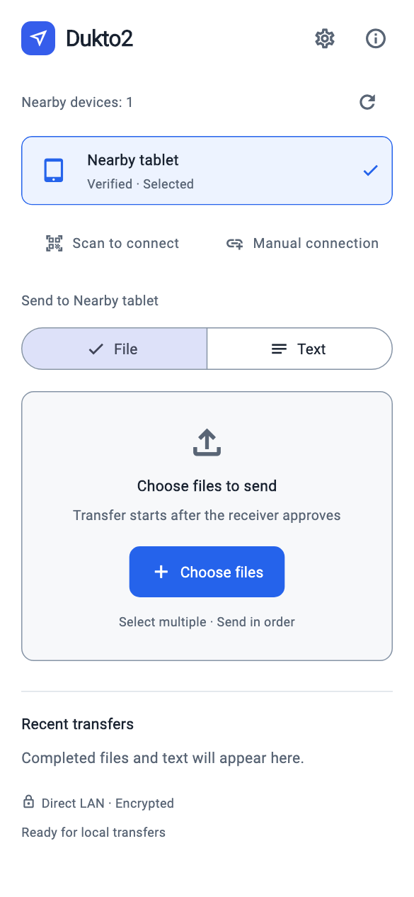
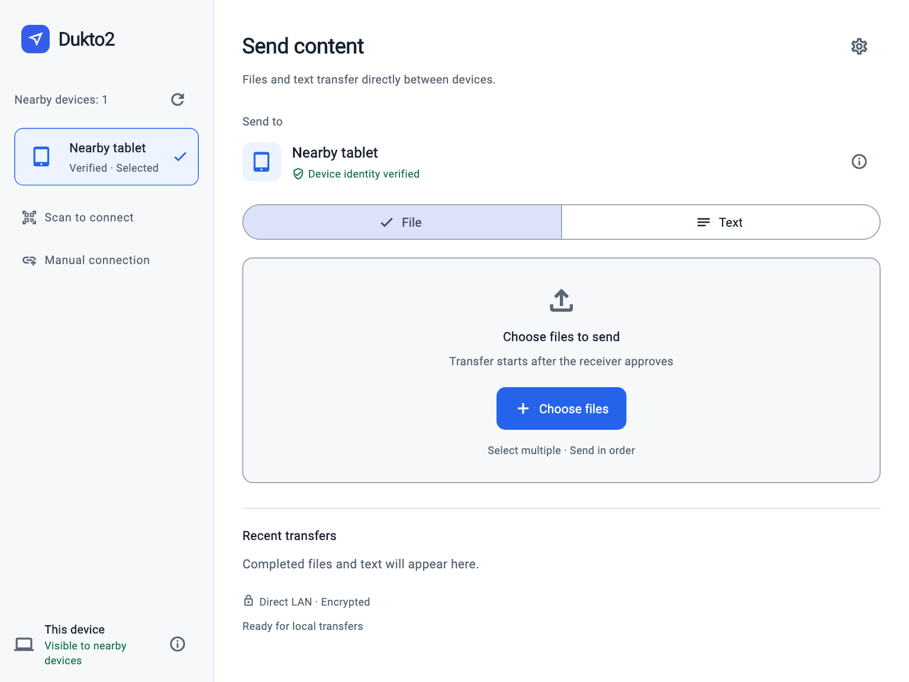

# English interface previews

English | [Simplified Chinese](README.md)

These images are rendered from the current Flutter widgets in English. They use a sample nearby device and an empty transfer history, and are UI previews rather than hardware captures or evidence of successful transfers.

## Desktop

## Phone

## Tablet

Regenerate these images with `./tool/flutterw test tool/render_english_previews.dart`. The renderer loads Flutter's bundled fonts, selects English explicitly, and checks visible text for Chinese characters.

Earlier Chinese and Arabic device captures remain in the [other-language screenshot archive](README.md). They are not used as English interface illustrations. Hardware and simulator transfer results, including their limits, are documented in [validation coverage](../en/validation.md).

Android hardware search captures (Chinese UI, REDMI K90, 0.1.6-rc.5 workspace, 2026-10-21): [searching](android-discovery-search.png) / [finished](android-discovery-ready.png). These show an actual pull gesture and the existing nearby Mac. History entries are from earlier tests; no new file transfers were performed in this round.

Windows 11 x64 hardware captures (Chinese UI, commit `7e6d7a4`, 2026-10-21): [searching](windows-discovery-search.png) / [finished](windows-discovery-ready.png). These show the actual Dukto2 window after button-triggered discovery. No new transfers were performed; manual physical-touchscreen pull was not validated.
